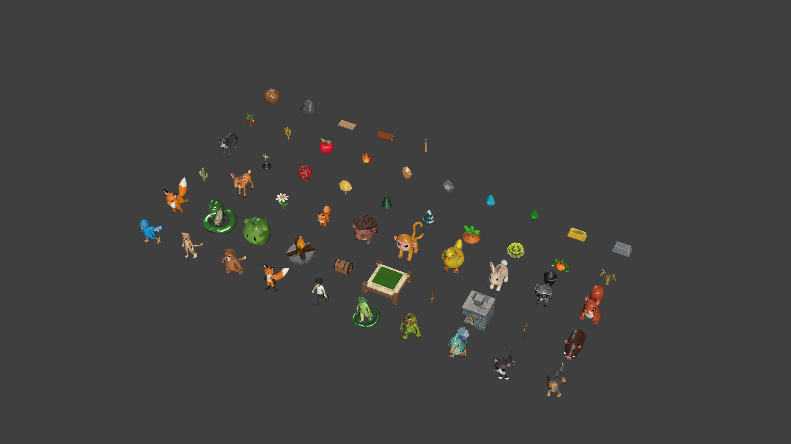
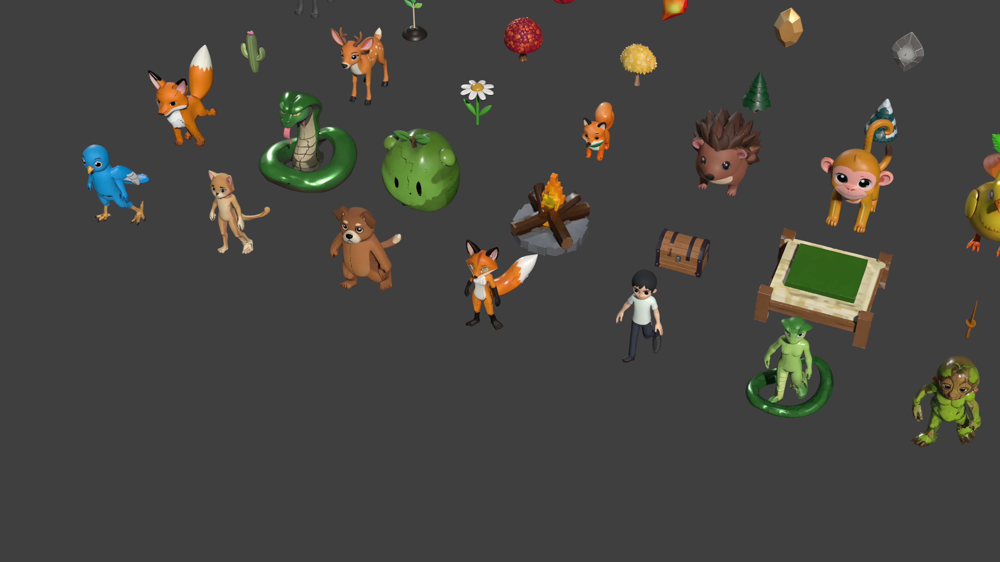
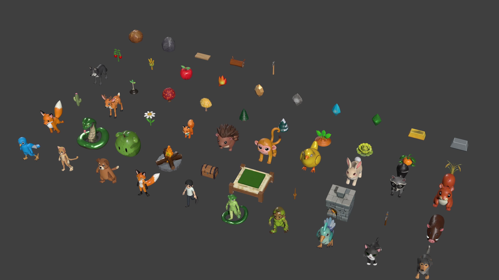

# PolyGarden

A curated pack of **AI-generated stylized low-poly game assets**, exported as native
Blender sources and glTF binaries. Ships with ready-to-use humanoid skeletons for
animated characters.

**55 models · 13 rigged · 23,332 tris each · MIT licensed**



---

## What's inside

```
PolyGarden/
├── models/
│   ├── blender/     55 × .blend   native Blender 5.0 sources, textures packed
│   ├── glb/         55 × .glb     glTF 2.0 binary, no animation
│   └── rigs/        13 × .glb     skeleton-only rigs (armature, no mesh)
├── docs/            preview renders
├── catalog.json     machine-readable asset manifest
└── catalog.md       human-readable asset table
```

### Asset categories

| Category | Count | Contents |
|---|---:|---|
| `character_humanoid` | 7 | Biped characters + a coiled serpent figure |
| `character_beast` | 6 | Quadruped / bird-like creature bodies |
| `creature` | 18 | Animals, birds, small critters, plus a few props |
| `vegetation` | 5 | Trees (autumn / gold / pine / snow) and a sapling |
| `farm` | 7 | Crops and fruit |
| `ore_core` | 9 | Elemental cores, ore nodes, ingots |
| `wood` | 3 | Log, plank, pickaxe |

### Preview

<p align="center">
  
  
</p>

Every model carries the same triangle budget (23,332 tris) — they came out of a
generation pipeline with a uniform target. Heights range from 0.18 m (small props)
to 1.99 m (characters).

---

## Rigs

13 of the models ship with a **20-bone humanoid skeleton**, heat-diffuse weighted,
ready for animation. The same skeleton topology is shared across all of them:

```
root
└── hips
    ├── spine → chest → neck → head
    ├── shoulder.L → upper_arm.L → forearm.L → hand.L
    ├── shoulder.R → upper_arm.R → forearm.R → hand.R
    ├── thigh.L  → shin.L  → foot.L
    └── thigh.R  → shin.R  → foot.R
```

- **Weighted**: every vertex is bound, weights sum to exactly 1.0.
- **No animations**: this pack intentionally ships rigs *without* baked motion so
  you can drive them with your own clips. See [Scope](#scope).
- `models/rigs/<name>_rig.glb` contains the bare armature — handy for retargeting
  or for skinning a different mesh to the same skeleton.

---

## Formats

| Format | Files | Use it for |
|---|---:|---|
| `.blend` | 55 | Editing, re-rigging, re-texturing in Blender |
| `.glb` | 55 | Engine / web delivery (Unity, Unreal, three.js, Babylon, Godot) |
| `_rig.glb` | 13 | Retargeting, skeleton reuse, alternative skinning |

All `.blend` files have their textures **packed**, so they open correctly on any
machine with no external image dependencies.

---

## Conventions

All assets share a normalised transform so they drop straight into a scene:

| Property | Value |
|---|---|
| Units | meters |
| Scale | 1.0 (real-world size, ~1.8–2.0 m tall for characters) |
| Origin | between the feet, centred on X/Y |
| Up axis | **Z-up** in `.blend`, **Y-up** in `.glb` (standard glTF conversion) |
| Facing | characters face −Y in `.blend` |

Grid layouts, studio lights and cameras used to produce the previews are **not**
included — each file is a single clean model.

---

## Scope

**What this pack does not contain, by design:**

- No animation clips, no baked motion, no action data
- No shared library scene, rig-instancing collection, or staging environment
- No textures as loose files (they are packed inside each `.blend` and embedded in
  each `.glb`)

Everything here is geometry, materials, textures and skeletons — bring your own
animation.

---

## Provenance

**Every model in this repository was generated by AI.** The meshes, the baked
textures and the rig weighting are the output of an AI image-to-3D generation
pipeline, exported and cleaned up with Blender. No assets are traced from, derived
from, or copied out of any existing game, film, or commercial product.

If you intend to use these commercially, that is fine — the MIT license below
covers it. Please do read the provenance note: some AI-3D outputs carry
residual artifacts from their training data, and shipping assets in a commercial
title is your responsibility to vet.

---

## License

MIT — see [LICENSE](LICENSE).

```
MIT License

Copyright (c) 2026 David-chinese-wei

Permission is hereby granted, free of charge, to any person obtaining a copy
of this software and associated documentation files (the "Software"), to deal
in the Software without restriction, including without limitation the rights
to use, copy, modify, merge, publish, distribute, sublicense, and/or sell
copies of the Software, and to permit persons to whom the Software is
furnished to do so, subject to the following conditions:

The above copyright notice and this permission notice shall be included in all
copies or substantial portions of the Software.

THE SOFTWARE IS PROVIDED "AS IS", WITHOUT WARRANTY OF ANY KIND, EXPRESS OR
IMPLIED, INCLUDING BUT NOT LIMITED TO THE WARRANTIES OF MERCHANTABILITY,
FITNESS FOR A PARTICULAR PURPOSE AND NONINFRINGEMENT. IN NO EVENT SHALL THE
AUTHORS OR COPYRIGHT HOLDERS BE LIABLE FOR ANY CLAIM, DAMAGES OR OTHER
LIABILITY, WHETHER IN AN ACTION OF CONTRACT, TORT OR OTHERWISE, ARISING FROM,
OUT OF OR IN CONNECTION WITH THE SOFTWARE OR THE USE OR OTHER DEALINGS IN THE
SOFTWARE.
```

---

## Regenerating

The pack is rebuilt from a single source scene by a small set of Blender scripts.
Run `export_package.py` against the master `.blend` to reproduce
`models/blender`, `models/glb` and `models/rigs` byte-for-byte in structure.